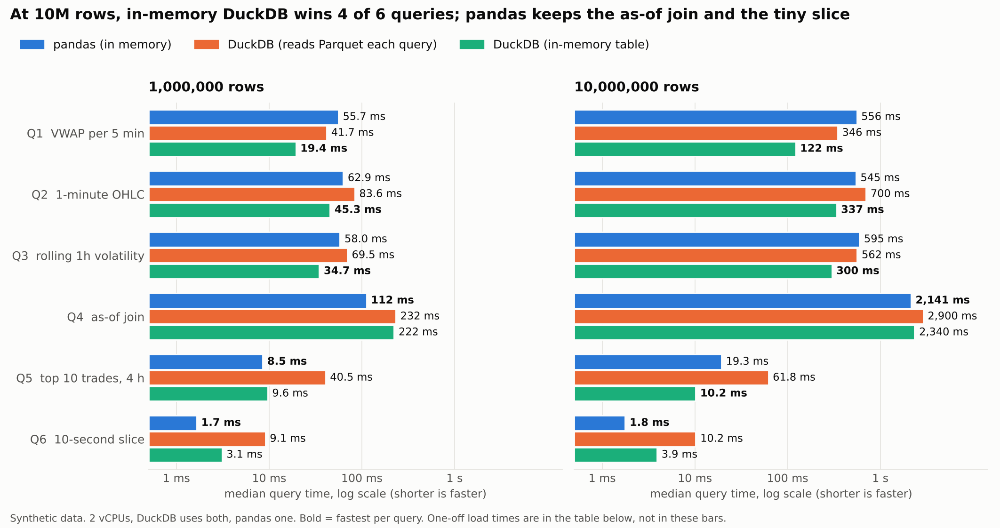

# Market Time Machine

Replay a market day tick by tick, query it with several engines, and see which one wins and why.
The project is a learning and portfolio build around time-series databases: pandas as the baseline,
DuckDB as a modern columnar engine, and (later) Kdb+/Q.

> **Status: weeks 1-2 of 5.** Data pipeline, Parquet store, three engines (pandas, DuckDB on
> Parquet, DuckDB in memory) answering six queries, a pure-Python reference, parity tests, and a
> benchmark harness with results at 1M and 10M rows. API, replay UI, Sonify, Day Fingerprint,
> leaderboard and Kdb+/Q come in later weeks.

## Quick start

```bash
make install        # pip install -e ".[dev]"
make test           # parity, ingest and generator tests
make ingest-synth   # write 5 synthetic days of BTCUSDT and ETHUSDT ticks to data/parquet
make demo           # run all queries on every engine, check agreement, print rough timings
make bench          # rebuild datasets and rerun the full benchmark (about 2 minutes)
```

## About the data

Real tick data comes from Binance's free public trade files (data.binance.vision). The ingest code
for those files is in `mtm/ingest/binance.py`, with explicit parsing, checksum verification and data
quality checks. **It has been tested against fixture files written to match the documented layout,
not against live downloads** (the development sandbox could not reach the site). Verify the column
layout and timestamp units on a real file the first time you run `make ingest`.

Until then, `make ingest-synth` produces a deterministic synthetic market: volatility regimes,
intraday volume seasonality, and BTC and ETH moving together. It is clearly synthetic and is
never presented as real data. It exists so the engines, tests and benchmarks can be built and
reproduced offline.

## Layout

```text
mtm/
  schema.py          # trade schema shared by every component
  ingest/            # binance parser, quality checks, synthetic generator
  store.py           # partitioned Parquet writer and day summaries
  queries.py         # named benchmark queries (Q1-Q6)
  engines/           # Engine protocol, pandas, DuckDB (Parquet and in-memory), reference
  bench.py           # benchmark harness (isolated workers, medians, agreement checks)
  plot.py            # chart and Markdown table from the results file
  cli.py             # ingest and demo commands
tests/               # ingest, generator, engine parity and harness tests
bench/results/       # committed benchmark results (JSON)
docs/                # rendered charts
```

## Queries implemented

| ID | Query |
| --- | --- |
| Q1 | VWAP, volume and trade count per N-minute window |
| Q2 | 1-minute OHLC bars |
| Q3 | Rolling 1-hour realized volatility from 1-minute closes |
| Q4 | As-of join: each ETH trade matched to the latest BTC price at or before it (no look-ahead) |
| Q5 | The N largest trades in a time range |
| Q6 | Trade count and volume in a narrow time slice |

## Results (synthetic data, week 2)



**1,000,000 BTCUSDT rows** (median of 7 warm runs)

| Query | pandas (in memory) | DuckDB (reads Parquet each query) | DuckDB (in-memory table) |
| --- | ---: | ---: | ---: |
| Q1  VWAP per 5 min | 55.7 ms | 41.7 ms | **19.4 ms** |
| Q2  1-minute OHLC | 62.9 ms | 83.6 ms | **45.3 ms** |
| Q3  rolling 1h volatility | 58.0 ms | 69.5 ms | **34.7 ms** |
| Q4  as-of join | **112 ms** | 232 ms | 222 ms |
| Q5  top 10 trades, 4 h | **8.5 ms** | 40.5 ms | 9.6 ms |
| Q6  10-second slice | **1.7 ms** | 9.1 ms | 3.1 ms |
| *One-off load* | *0.10 s* | *0.00 s* | *0.22 s* |
| *Peak memory* | *323 MB* | *303 MB* | *356 MB* |

**10,000,000 BTCUSDT rows** (median of 7 warm runs)

| Query | pandas (in memory) | DuckDB (reads Parquet each query) | DuckDB (in-memory table) |
| --- | ---: | ---: | ---: |
| Q1  VWAP per 5 min | 556 ms | 346 ms | **122 ms** |
| Q2  1-minute OHLC | 545 ms | 700 ms | **337 ms** |
| Q3  rolling 1h volatility | 595 ms | 562 ms | **300 ms** |
| Q4  as-of join | **2,141 ms** | 2,900 ms | 2,340 ms |
| Q5  top 10 trades, 4 h | 19.3 ms | 61.8 ms | **10.2 ms** |
| Q6  10-second slice | **1.8 ms** | 10.2 ms | 3.9 ms |
| *One-off load* | *1.10 s* | *0.00 s* | *1.40 s* |
| *Peak memory* | *1,819 MB* | *1,454 MB* | *1,942 MB* |
Machine: Intel(R) Xeon(R) Processor @ 2.80GHz, 2 logical CPUs, 7.8 GB RAM, Python 3.13.18,
pandas 3.0.5, DuckDB 2.0.0, run on 2026-11-01.
Raw numbers, every warm run and DuckDB's `EXPLAIN ANALYZE` plans: `bench/results/week2_synthetic.json`.

**What the numbers say**

- **Once data is in memory, DuckDB wins the scan-heavy queries.** At 10M rows its in-memory table is
  4.6x faster than pandas on VWAP (Q1), 1.6x on OHLC (Q2), 2.0x on rolling volatility (Q3) and 1.9x on
  the top-N filter (Q5).
- **pandas keeps two.** It is faster on the as-of join (Q4, 2.1 s against 2.3 s) and on the 10-second
  slice (Q6, 1.8 ms against 3.9 ms). Q6 is a binary search on sorted data, so both finish in a few
  milliseconds and the gap does not matter in practice. The Q4 gap is small, and I have not tuned
  DuckDB's ASOF join, so I would not claim pandas is better at it.
- **The cost model matters more than the engine.** Querying Parquet directly needs no load step, so a
  single Q1 at 10M rows takes about 0.4 s end to end with DuckDB, against about 1.6 s for pandas
  (1.1 s to load, then the query). If you will run hundreds of queries on the same data, loading
  once wins; if you run one or two, reading in place wins.
- **Memory is similar.** Peak process memory at 10M rows was about 1.5 to 1.9 GB for every engine.
- **Scaling is roughly linear for scans.** Ten times the data cost 6x to 10x the time on Q1 to Q3, and
  the as-of join cost 19x on pandas against 10x to 12x on DuckDB. Q5 and Q6 moved little (1.1x to 2.3x),
  because time-range queries on sorted data skip most of the table.

**Fairness choices.** pandas reads only the four columns it needs and uses binary search for time
ranges on sorted data; it is vectorized throughout. DuckDB gets both CPU cores, pandas one, which is
how each runs by default. Each engine and size runs in its own process, one cold run is followed by
7 warm runs, and the table reports medians. After every run all engines' answers are compared
and must agree, and `tests/` checks them against a pure-Python reference.

**Limits of this evidence.** The data is synthetic, so real tick data (burstier, with different
tie and gap patterns) may change the numbers. The machine is a shared 2-vCPU VM, and run-to-run
noise on millisecond queries reaches about 1.7x between median and p95, so do not read much into
small gaps. 100M rows is not run yet: extrapolating from 1.8 GB at 10M rows, pandas would need roughly 18 GB
and this machine has 7.8 GB, so that run is expected to fail, and the failure will be recorded
rather than hidden when it is tried. Kdb+/Q is not benchmarked yet.

Every engine must return the same answer; `tests/` checks pandas and both DuckDB configurations
against a slow, obviously correct pure-Python reference, including hand-built cases for as-of
look-ahead, timestamp ties and half-open time ranges.
